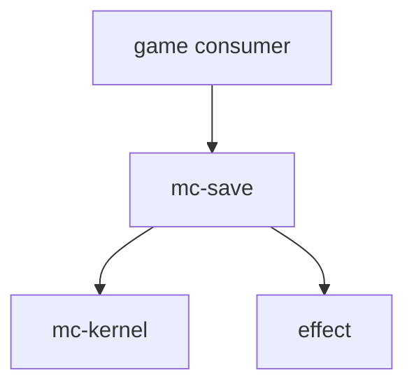

# Architecture

## Layers

mc-save provides persistence infrastructure without knowing the game's state model.

| Layer | Main modules | Responsibility |
| --- | --- | --- |
| Format | `format*.ts`, `format-definition.ts` | Schema, name, current version, encode, and decode |
| Integrity | `envelope.ts`, `integrity*.ts` | Canonical bytes, checksum, size checks, and sealed values |
| Persistence | `persistence.ts`, `save-preparation.ts`, `batch-save.ts`, `durable-save.ts` | Connect codecs to the port; single, batch, and durable operations |
| Application | `revisioned-save.ts`, `write-queue.ts` | Generic revision publication and sequential write mechanics |
| Adapter | `storage-port.ts`, `indexeddb-*.ts`, `storage-retry.ts` | Storage service, adapters, and retries |
| Save slices | `save-slices.ts` | Bundle codecs, migration paths, and restore preflight |
| Minecraft codecs | `minecraft-*.ts`, `anvil-region.ts` | Reusable Java wire and container implementations |

## Dependency direction



The arrows show package dependencies: mc-save imports `effect` and `@nerima-games/mc-kernel`, while consumer applications import and call mc-save. Consumers pass their schemas and values to mc-save at runtime; mc-save never imports a consumer package. It reuses the kernel's `WorldId`, coordinate brands and constants, and save-slice contracts. The `.oxlintrc.json` rules check dependency boundaries.

Consumer domain schemas stay in consumer packages. If mc-save needs to import a consumer, revisit the ownership boundary instead of adding the reverse dependency.

## Save data flow

```text
typed value
  -> Schema encode
  -> draft envelope
  -> canonical bytes / checksum / size validation
  -> sealed envelope
  -> StoragePort
  -> IndexedDB or another adapter
```

Reads follow the reverse path, but first validate the value returned by the storage medium against runtime schemas and integrity metadata. TypeScript annotations alone do not validate persisted data.

## IndexedDB boundary

Database, store, and index names, layout version, record conversion, and transaction error mapping are separated across `indexeddb-layout.ts`, `indexeddb-records.ts`, and `indexeddb-runtime.ts`. `indexeddb-surface.ts` describes only the DOM API shape the adapter needs, keeping DOM types out of the Node type environment. Fake IndexedDB in Node and real IndexedDB in Chromium exercise the same port contract.

The IndexedDB layout version is independent of save format versions. A layout upgrade changes the adapter's storage representation; it does not migrate an application's payload schema.

## Minecraft boundary

NBT is a tag wire codec. Anvil handles region headers, chunk records, sector packing, and compression. Consumers decide which tags make up level or chunk data. Standard path helpers are pure functions for Minecraft Java directory and resource conventions.
